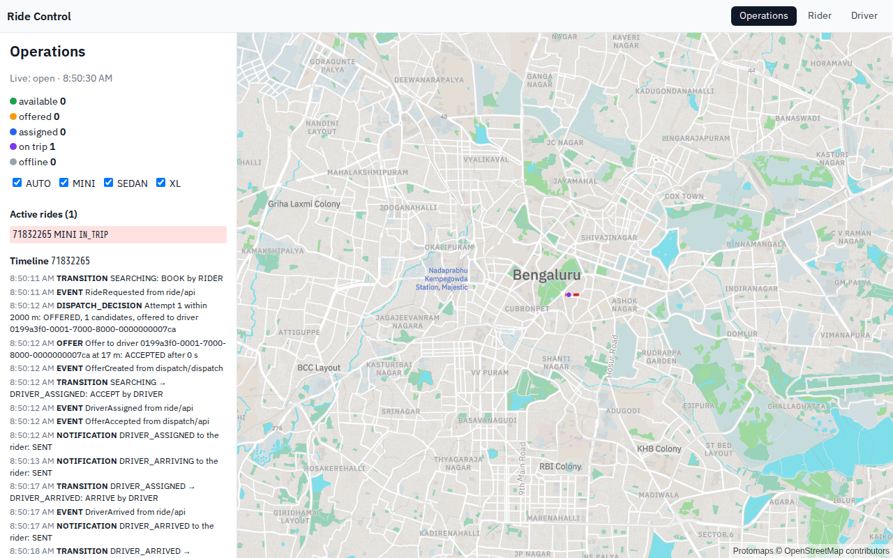

# Portfolio demo walkthrough

One live local trip, viewed by a rider, a driver and operations. These are captures of the running application
with seeded synthetic accounts, not UI mockups. The walkthrough is part of the separate
[portfolio checklist](portfolio-completion.md); it does not complete the original capacity or cloud roadmap.



## Follow the trip

| Step | What happens | Capture |
|---|---|---|
| Quote | The rider chooses pickup and drop-off and receives an upfront fare | [Rider quote, desktop](images/portfolio/rider-quote-desktop.png) |
| Assign | The driver accepts; the rider sees the vehicle and assigned state | [Assigned ride, PIN redacted](images/portfolio/rider-assigned-desktop.png) |
| Start and drive | Arrival and PIN verification advance the ride; driver positions update during the trip | [Driver trip, desktop](images/portfolio/driver-trip-desktop.png) |
| Track | The rider follows the trip on the mobile layout | [Rider trip, mobile](images/portfolio/rider-trip-mobile.png) |
| Explain | Operations inspects the active ride, dispatch decision, transitions and events | [Operations, desktop](images/portfolio/operations-desktop.png) and [mobile](images/portfolio/operations-mobile.png) |
| Complete | The trip completes and the rider submits a rating | [Completed ride after rating, mobile](images/portfolio/rider-completed-mobile.png) |

The browser test exercises the actual UI and API/WebSocket paths. It checks nonblank map pixels, desktop and
390-by-844 mobile layouts, absence of horizontal overflow, the operations timeline, trip completion and rating.
External HTTP requests are blocked during the test; map tiles, sprites and fonts are served locally. Basemap
attribution remains visible in the screenshots.

Payments remain mocked and notifications are log-only. The browser walkthrough is not a payment-settlement test;
the existing [scripted demo](../scripts/demo.sh) separately exercises the mocked charge, receipt and driver earnings.
This is a functional recording, not evidence for sustained capacity, browser latency targets or improved matching.

## Reproduce the recording

Use the [isolated local setup](portfolio-completion.md#isolated-local-setup-p4) with the compact map fixture.
Use a disposable seeded demo environment, not production or a database used for another active scenario. The
walkthrough uses driver 1994, rider 9002 and the seeded operations account. Keep those accounts free of unfinished
rides before recording.

With Node 22 or later and Docker available, from the repository root:

```bash
npm --prefix web ci
node scripts/record-portfolio.mjs
```

The recorder defaults to `http://127.0.0.1:18088`. It derives the Linux Playwright image version from the locked
dependency and checks the installed package matches. It uses host networking, a 2 GiB browser limit and 512 MiB
shared memory. This path is verified with Linux containers on Colima; Docker Desktop requires its host-networking
support to be enabled. Other runtime/network combinations are not certified by this capture.

To select another secure origin or a new capture directory:

```bash
WEB_BASE_URL=http://127.0.0.1:18088 \
  node scripts/record-portfolio.mjs build/portfolio/my-new-capture
```

Output directories must be new and under `build/portfolio`. The command refuses existing directories rather than
overwrite evidence. It writes `capture.json` with the source revision, dirty-worktree flag, test/configuration/lock
hashes, image version, resource settings and exit status. A successful run must also produce Playwright's passing
last-run result.

Under `test-results/<walkthrough>/`, the named videos are `rider-walkthrough.webm`, `driver-walkthrough.webm` and
`operations-walkthrough.webm`, alongside the screenshots. The three videos show the same synchronized test session
from different pages; they are not edited together. Open them in a WebM-capable browser or player. Raw videos and
test artifacts remain in ignored build output to avoid adding large recordings to Git history.

## Verified capture

| Field | Evidence |
|---|---|
| Recorded | 2026-10-13, 08:49:51 to 08:51:16 UTC |
| Application base revision | `2905def67ff799123f5623ba88685dd1f8227817` |
| Capture test changes | Working-tree changes recorded as dirty, with exact file hashes in the local manifest |
| Browser image | `mcr.microsoft.com/playwright:v1.64.0-noble` |
| Result | Passing three-role recording, approximately 1.4 minutes |
| Local evidence | `build/portfolio/capture-2026-10-13T08-49-51-816Z` |
| Published assets | Seven reviewed screenshots linked above; large videos retained locally |

## Privacy and failure handling

- Recording mode visually hides the rider PIN and driver PIN input, and asserts those styles before using them.
  Screenshot capture also masks these elements. The test still reads the real PIN from the application to start
  the trip; redaction does not bypass verification.
- API diagnostics retain at most 100 method/path/status entries, with no request bodies, tokens, headers or query
  strings. Failed-run DOM snapshots and other raw artifacts should stay private until reviewed; only reviewed
  images from a passing recording are included here.
- `http://web` inside a Docker bridge is not a secure browser origin: `crypto.randomUUID()` is unavailable there.
  Use HTTPS or loopback HTTP. The walkthrough now fails early with that requirement instead of failing later on
  a ride command. Do not disable browser security to work around it.
- A 1 GiB browser container caused Chromium page crashes; Docker OOM events confirmed the cause. The passing
  recording used 2 GiB for the browser, within the existing 4 GiB VM alongside the small demo stack. These are
  recording-tool resource needs, not application capacity measurements.
- The native Playwright video encoder did not support the development Mac's OS version. Recording in the matching
  Linux image resolved that tooling limitation without changing the application.
- Cleanup of the isolated application stack is described in the [setup guide](portfolio-completion.md#safe-cleanup).
  The recording command removes only its short-lived browser container; it never deletes application data.